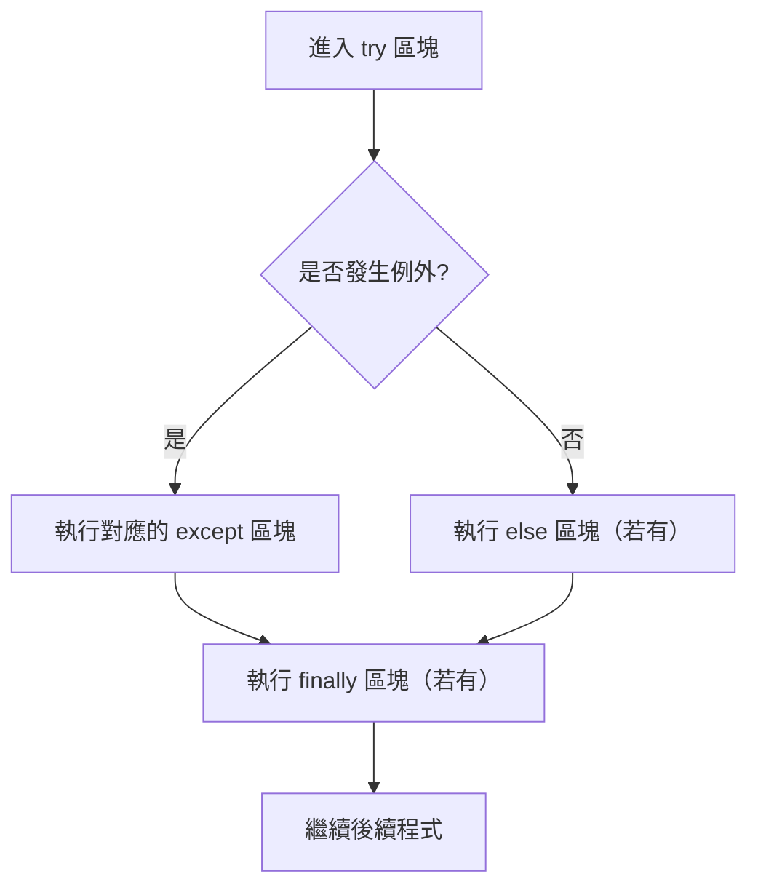

# Python 例外處理完整教學講義：`try ... except` 由淺至深

> **課程日期**：2026-11-25  
> **適用環境**：Python 3.12+  
> **學習目標**：從「防止程式閃退」的基礎觀念出發，逐步掌握精準捕捉、資源清理、主動拋出與自訂例外，並能寫出符合工程實務的強健（Robust）程式碼。

---

## 目錄

- [Level 1：初識例外（入門觀念）](#level-1初識例外入門觀念)
- [Level 2：精準捕捉與錯誤資訊（基礎應用）](#level-2精準捕捉與錯誤資訊基礎應用)
- [Level 3：完整生命週期控制（中階結構）](#level-3完整生命週期控制中階結構)
- [Level 4：主動掌控與進階機制（進階設計）](#level-4主動掌控與進階機制進階設計)
- [Level 5：實務風格與最佳實踐（工程實務）](#level-5實務風格與最佳實踐工程實務)
- [Level 6：課堂隨堂練習（動手實作）](#level-6課堂隨堂練習動手實作)

---

## Level 1：初識例外（入門觀念）

### 1.1 語法錯誤 vs. 執行期例外

寫 Python 時常見的錯誤分為兩大類：

1. **語法錯誤（`SyntaxError`）**：程式尚未開始執行，在解析階段就被擋下（例如少冒號、括號沒成對）。這類錯誤無法用 `try...except` 攔截，必須直接修正程式碼。
2. **執行期例外（`Exception`）**：語法完全正確，但執行過程中遇到預期之外的狀況（例如除以零、使用者輸入非數字文字），導致程式中斷並印出 **Traceback（錯誤追蹤訊息）**。

```python
# 常見執行期例外範例（未處理時會直接中斷程式）
10 / 0              # ZeroDivisionError: division by zero
int("abc")          # ValueError: invalid literal for int() with base 10: 'abc'
[1, 2][5]           # IndexError: list index out of range
{"a": 1}["b"]       # KeyError: 'b'
```

### 1.2 為什麼需要例外處理？

如果沒有例外處理，只要一行出錯，整個程式就會立刻崩潰。透過 `try...except`，我們可以：
- **維持程式穩定**：出錯時改走備案流程，而不是直接閃退。
- **提供友善訊息**：把生硬的 Traceback 轉換成使用者看得懂的提示。
- **安全釋放資源**：確保開啟的檔案或連線在出錯時依然能正確關閉。

### 1.3 最基礎的 `try ... except`

```python
print("=== 程式開始 ===")

try:
    num = int(input("請輸入一個整數: "))
    print(f"100 除以 {num} 的結果為 {100 / num}")
except:
    print("輸入或計算過程發生錯誤，請重新確認！")

print("=== 程式正常結束 ===")
```

- **`try` 區塊**：放「可能會出錯」的程式碼。
- **`except` 區塊**：當 `try` 內發生例外時，立即中斷 `try` 剩餘程式碼並跳入 `except` 執行。

---

## Level 2：精準捕捉與錯誤資訊（基礎應用）

### 2.1 為什麼不要用裸露的 `except:`？

不指定型態的 `except:`（稱為 Bare except）會把**所有**錯誤一網打盡——就連變數名稱打錯的 `NameError` 或按下 `Ctrl+C` 的 `KeyboardInterrupt` 也會被攔下來，導致真正的 Bug 被掩蓋。

**正確做法：明確指定要捕捉的例外型態。**

### 2.2 多個 `except` 分支與合併捕捉

```python
try:
    a = int(input("請輸入被除數: "))
    b = int(input("請輸入除數: "))
    result = a / b
    print(f"結果：{result}")
except ValueError:
    print("格式錯誤：請輸入有效的整數！")
except ZeroDivisionError:
    print("數學錯誤：除數不可為 0！")
```

如果多個例外需要**相同的處理方式**，可以用 tuple 合併：

```python
try:
    data = {"count": "ten"}
    value = int(data["count"])
except (KeyError, ValueError) as e:
    print(f"資料讀取或轉換失敗：{e}")
```

### 2.3 使用 `as e` 取得錯誤詳細資訊

透過 `as e` 可以取得例外物件本身，方便除錯或記錄日誌：

```python
try:
    with open("not_exist.txt", "r", encoding="utf-8") as f:
        print(f.read())
except FileNotFoundError as e:
    print(f"找不到檔案！詳細資訊：{e}")
    print(f"例外型態：{type(e).__name__}")
```

---

## Level 3：完整生命週期控制（中階結構）

Python 的例外處理共有四個關鍵字：`try`、`except`、`else`、`finally`。



### 3.1 `else` 與 `finally` 的分工

- **`else`**：只有在 `try` 區塊**完全沒有發生例外**時才執行。好處是把「確定不會出錯的後續邏輯」移出 `try`，避免誤捕不相關的錯誤。
- **`finally`**：**無論是否發生例外**（甚至在 `try` 或 `except` 中遇到 `return`），都一定會執行，常用於關閉檔案、資料庫連線或釋放鎖定。

```python
def read_number_from_file(path: str) -> int | None:
    f = None
    try:
        f = open(path, "r", encoding="utf-8")
        content = f.read().strip()
        number = int(content)
    except FileNotFoundError:
        print(f"錯誤：找不到檔案 {path}")
        return None
    except ValueError as e:
        print(f"錯誤：檔案內容不是有效整數（{e}）")
        return None
    else:
        print("讀取與轉換皆成功！")
        return number
    finally:
        if f is not None:
            f.close()
            print("檔案資源已安全關閉。")
```

> **實務小提醒**：讀寫檔案時，使用 `with open(...) as f:`（Context Manager）會自動幫你處理 `finally: f.close()`，程式碼更簡潔安全。

---

## Level 4：主動掌控與進階機制（進階設計）

### 4.1 主動拋出例外：`raise`

有時候程式語法與型態都沒錯，但**違反了業務邏輯**（例如年齡為負數、餘額不足、除數為零），這時應該用 `raise` 主動拋出例外，清楚拒絕不合法的呼叫。

參考課堂範例 [`calc.py`](file:///C:/Users/User/Documents/python/test_20261111/2026_11_25/calc.py)：

```python
def divide(a: float, b: float) -> float:
    """Return a divided by b, raising ValueError if b is zero."""
    if b == 0:
        raise ValueError("除數不可為零")
    return a / b
```

呼叫端可以這樣接住並處理：

```python
try:
    print(divide(10, 0))
except ValueError as e:
    print(f"計算失敗：{e}")
```

### 4.2 例外鏈（Exception Chaining）：`raise ... from ...`

當你在底層捕捉到一個技術性例外（例如 `KeyError`），想轉拋成對上層更有意義的例外時，使用 `raise NewError(...) from e` 可以**保留原始錯誤的追蹤鏈**，不會遺失根本原因：

```python
def get_user_age(config: dict) -> int:
    try:
        return int(config["age"])
    except (KeyError, ValueError) as e:
        raise RuntimeError("無法取得合法的使用者年齡設定") from e
```

### 4.3 自訂例外類別（Custom Exception）

大型專案中，建議繼承 `Exception` 建立具語意化的自訂例外，讓呼叫端能精確區分「系統錯誤」與「業務規則錯誤」：

```python
class InsufficientBalanceError(Exception):
    """餘額不足時拋出的自訂例外。"""

    def __init__(self, balance: float, amount: float) -> None:
        self.balance = balance
        self.amount = amount
        super().__init__(f"餘額不足：目前餘額 {balance}，嘗試提款 {amount}")


def withdraw(balance: float, amount: float) -> float:
    if amount <= 0:
        raise ValueError("提款金額必須大於 0")
    if amount > balance:
        raise InsufficientBalanceError(balance, amount)
    return balance - amount
```

### 4.4 認識 Python 例外繼承階層

所有例外都繼承自 `BaseException`，但**一般程式只應該捕捉 `Exception` 及其子類別**：

```text
BaseException
 ├── SystemExit          # sys.exit() 觸發，不應隨意攔截
 ├── KeyboardInterrupt   # Ctrl+C 中斷，不應隨意攔截
 └── Exception           # 所有一般程式例外的共同父類別
      ├── ArithmeticError (ZeroDivisionError, ...)
      ├── LookupError (IndexError, KeyError)
      ├── OSError (FileNotFoundError, ...)
      ├── ValueError
      └── TypeError
```

> **順序原則**：寫多個 `except` 時，**子類別必須放在父類別前面**。例如 `FileNotFoundError` 是 `OSError` 的子類別，若把 `except OSError:` 寫在前面，底下的 `except FileNotFoundError:` 永遠不會被執行到。

---

## Level 5：實務風格與最佳實踐（工程實務）

### 5.1 EAFP vs. LBYL

- **LBYL（Look Before You Leap，三思而後行）**：執行前先用一堆 `if` 檢查（常見於 C / Java）。
- **EAFP（Easier to Ask for Forgiveness than Permission，先做再請求原諒）**：Python 社群推崇的風格，直接嘗試執行，出錯再交給 `try...except` 處理。

```python
# LBYL 寫法
if "age" in user and isinstance(user["age"], int):
    age = user["age"]
else:
    age = 0

# EAFP 寫法（更 Pythonic，也能避免檢查與執行之間的時間差問題）
try:
    age = int(user["age"])
except (KeyError, TypeError, ValueError):
    age = 0
```

### 5.2 常見地雷整理

| 地雷寫法 | 問題說明 | 正確替代方案 |
| :--- | :--- | :--- |
| `except: pass` | 默默吞掉所有錯誤，出問題完全無從追查 | 至少指定型態並記錄 `logging.exception()` |
| `try` 包住幾百行程式 | 不知道哪一行出錯，容易誤捕不相干的例外 | 縮小 `try` 範圍，只包住「真正可能出錯」的幾行 |
| 只用 `print(e)` 除錯 | 正式環境看不到完整呼叫堆疊（Traceback） | 使用 `logging.exception("發生錯誤")` |

---

## Level 6：課堂隨堂練習（動手實作）

### 練習 1（基礎）：安全除法計算機
請撰寫一個函式 `safe_divide()`，持續要求使用者輸入兩個數字並計算 `a / b`：
- 若輸入非數字，提示「請輸入數字」並讓使用者重新輸入。
- 若除數為 0，提示「除數不能為 0」並讓使用者重新輸入。
- 計算成功後印出結果並結束迴圈。

<details>
<summary>點擊查看參考解答</summary>

```python
def safe_divide() -> None:
    while True:
        try:
            a = float(input("請輸入被除數: "))
            b = float(input("請輸入除數: "))
            result = a / b
        except ValueError:
            print("輸入格式錯誤，請輸入數字！")
        except ZeroDivisionError:
            print("除數不能為 0，請重新輸入！")
        else:
            print(f"計算結果：{result}")
            break
```

</details>

---

### 練習 2（進階）：自訂例外與銀行提款
使用 Level 4 的 `InsufficientBalanceError` 與 `withdraw(balance, amount)`，撰寫一段測試程式：
- 初始餘額為 `1000`。
- 嘗試提款 `-100` 與 `1500`，分別捕捉 `ValueError` 與 `InsufficientBalanceError` 並印出對應訊息。
- 無論成功或失敗，最後都在 `finally` 印出 `"交易流程結束"`。

<details>
<summary>點擊查看參考解答</summary>

```python
for attempt in (-100, 1500, 500):
    try:
        new_balance = withdraw(1000, attempt)
    except ValueError as e:
        print(f"[參數錯誤] {e}")
    except InsufficientBalanceError as e:
        print(f"[業務錯誤] {e}（尚缺 {e.amount - e.balance}）")
    else:
        print(f"[交易成功] 剩餘餘額：{new_balance}")
    finally:
        print("交易流程結束\n")
```

</details>

---

### 練習 3（除錯）：找出底下程式碼的 3 個問題

```python
try:
    data = [10, 20, 30]
    idx = int(input("請輸入索引: "))
    print(data[idx])
except Exception as e:
    print("發生一般錯誤")
except IndexError:
    print("索引超出範圍")
except:
    pass
```

<details>
<summary>點擊查看解答</summary>

1. **`except IndexError:` 永遠不會被執行**：因為 `Exception` 是 `IndexError` 的父類別，放在前面會先攔截所有一般例外。應把 `IndexError` 移到 `Exception` 前面。
2. **缺少 `ValueError` 的提示**：`int(input(...))` 若輸入非數字會觸發 `ValueError`，建議明確捕捉 `ValueError`。
3. **不應使用 `except: pass`**：裸露的 `except:` 會吞掉系統例外且在 `Exception` 之後顯得多餘，應移除。

</details>
